##RESULTS

## 1. Data Cleaning and Preprocessing

The REFIT dataset was preprocessed to ensure chronological consistency, handle missing readings, and identify long-duration outages before conducting washing-machine EDA and appliance disaggregation.

### Cleaning Steps

1. **Chronological sorting:** Sorted readings by timestamp to preserve the time-series order.
2. **Duplicate removal:** Removed duplicate timestamps using the defined deduplication rule. The final dataset contains zero duplicate timestamps.
3. **Short-gap interpolation:** Interpolated short missing gaps to maintain continuity in the time series.
4. **Long-outage handling:** Flagged extended periods of missing aggregate-power readings instead of filling them without justification.
5. **Data validation:** Checked missing-value counts, appliance power statistics, timestamp ordering, and the dataset's final shape.
6. **Final dataset:** Retained 920,031 rows and 11 columns, covering 9 October 2013 to 10 July 2015.

### Data Quality Results

The final dataset is chronologically ordered and contains no duplicate timestamps. Aggregate power has 114,544 missing readings (12.45%), which are represented by the long-outage flag rather than being treated as zero consumption. Missingness varies across appliance channels, with Appliance9 having the highest missing-value percentage at 22.54%.

Short gaps were handled through interpolation, while longer outages were flagged to avoid introducing unjustified power values. The cleaned dataset was then used for exploratory analysis and subsequent modeling.

### Figure 1. Before and After Data Cleaning

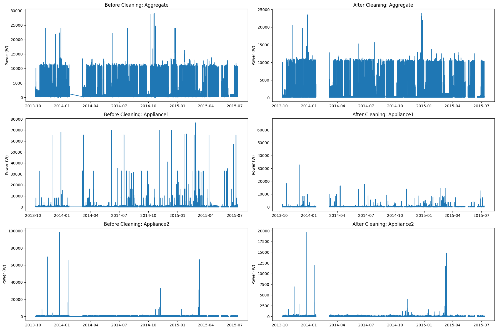

### Figure 2. Aggregate and Appliance Power vs. DateTime

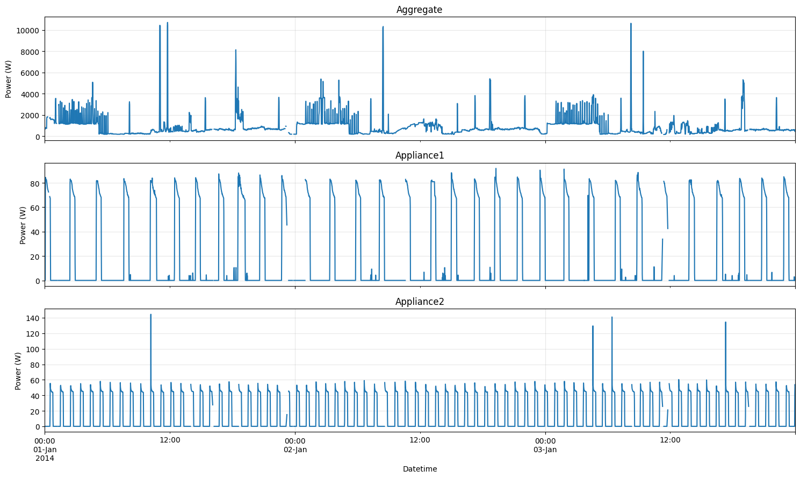

The first figure illustrates the effect of the cleaning process on the power readings. The second figure provides a time-series view of aggregate household consumption and selected appliance channels, helping verify the continuity and variation of power readings after preprocessing.

These validation steps establish a consistent dataset for the subsequent exploratory data analysis (EDA) and washing-machine power disaggregation tasks.

## 2. Washing-Machine EDA

### 2.1 Detected Events and Energy

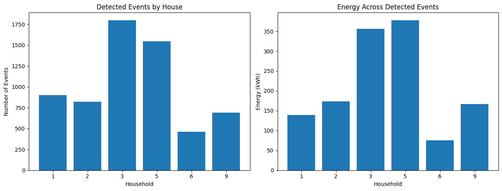
### 2.2 Usage by Hour

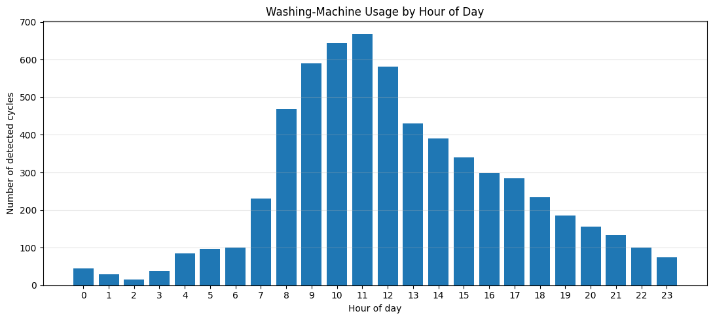
### 2.3 Usage by Day of Week

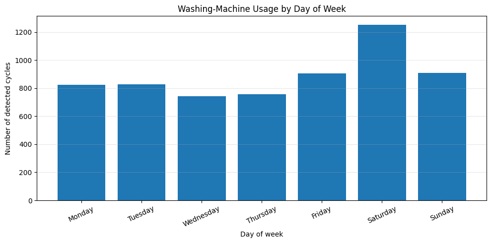
### 2.4 Household-Level Usage Patterns

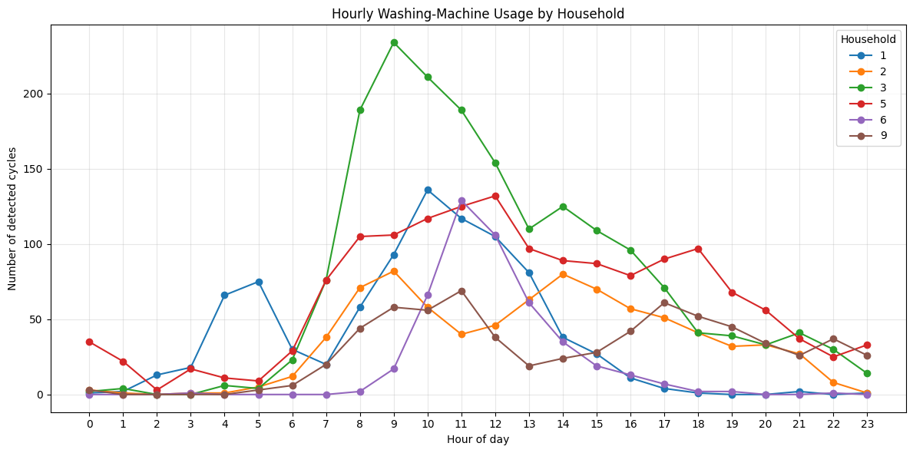

### 2.5 Cycle Characteristics

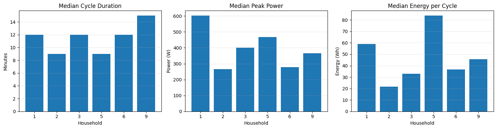

The EDA shows how washing-machine usage varies across households and time. The analysis highlights differences in event frequency, hourly and weekly usage patterns, and cycle-level characteristics such as duration, peak power, and energy consumption. These observations provide context for the subsequent appliance disaggregation model

## 3. Overall Model Results

Three approaches were evaluated on the combined test set: Always-off, Usage-profile, and Random Forest.

Model	MAE_W	RMSE_W	R2	Active_MAE_W	Active_minutes	Test_minutes
0	Always-off	19.704	169.455	-0.014	404.114	31687	651223
1	Usage-profile	33.361	166.790	0.018	371.022	31687	651223
2	Random Forest	25.160	141.299	0.295	297.896	31687	651223

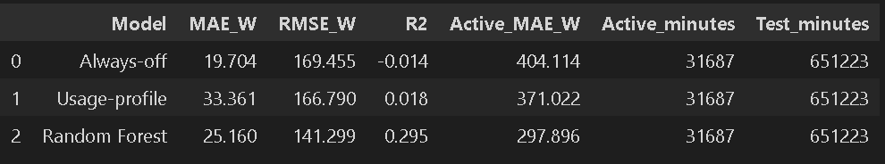

The Random Forest achieved the lowest RMSE, highest R², and lowest active-period MAE, indicating better performance in identifying and estimating washing-machine activity. Although the Always-off baseline achieved the lowest overall MAE, this is largely because the washing machine remains inactive for most timestamps.

## 4. Household-Level Test Results

A 70/15/15 chronological split was used for each household, with 70% of the data for training, 15% for validation, and 15% for testing. This preserves the temporal ordering of the REFIT data and prevents future observations from being used to predict earlier observations.

House	Model	MAE_W	RMSE_W	R2	Active_MAE_W	Active_minutes	Test_minutes
0	1	Always-off	10.286	131.549	-0.006	493.310	2399	115172
2	1	Random Forest	11.596	97.388	0.449	279.428	2399	115172
1	1	Usage-profile	19.242	130.844	0.005	473.073	2399	115172
3	2	Always-off	20.316	183.129	-0.012	387.051	5065	96948
5	2	Random Forest	32.212	159.918	0.228	272.297	5065	96948
4	2	Usage-profile	34.148	181.397	0.007	364.007	5065	96948
6	3	Always-off	28.177	202.995	-0.020	491.230	6568	114542
8	3	Random Forest	34.220	162.432	0.347	335.454	6568	114542
7	3	Usage-profile	47.873	199.210	0.018	444.656	6568	114542
9	5	Always-off	34.515	201.935	-0.030	326.064	12807	121203
11	5	Random Forest	46.623	191.433	0.074	296.894	12807	121203
10	5	Usage-profile	53.543	196.078	0.029	290.481	12807	121203
12	6	Always-off	6.358	95.714	-0.004	354.008	1827	101840
14	6	Random Forest	6.865	60.319	0.601	176.528	1827	101840
13	6	Usage-profile	12.419	95.393	0.002	332.972	1827	101840
15	9	Always-off	15.947	167.851	-0.009	533.678	3021	101518
17	9	Random Forest	16.318	125.386	0.437	351.469	3021	101518
16	9	Usage-profile	29.164	166.738	0.004	506.103	3021	101518

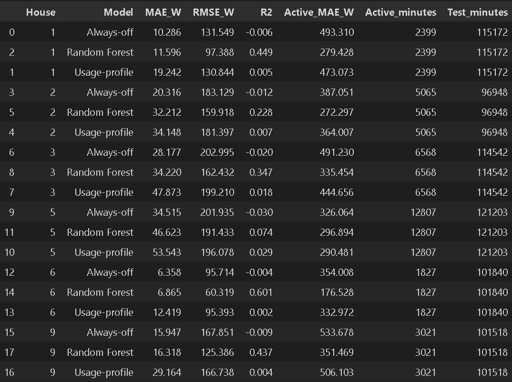

Random Forest generally improved RMSE and active-period MAE across households, although performance varied by household. House 6 achieved the strongest Random Forest performance with an R² of 0.601 and an active-period MAE of 176.528 W.

## 5. Actual vs Predicted

### 5.1 House 5: Actual vs Predicted

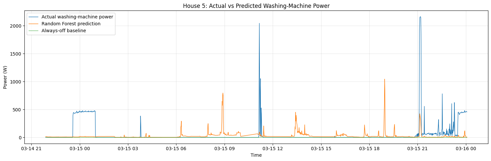
### 5.1 House 5: Actual vs Predicted (6 Hours)
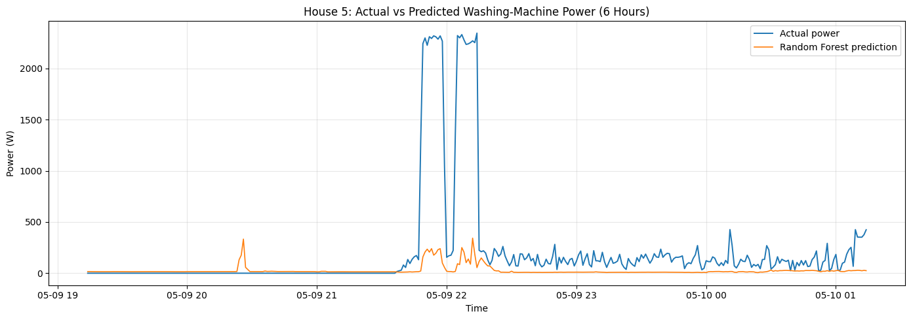

The actual-versus-predicted plots show that the model captures general washing-machine activity but has difficulty reproducing some high-power peaks and short-duration variations.

## 6. Failure Analysis

The Random Forest model sometimes underestimated high-power washing-machine events, particularly peaks around 2,200 W in House 5. It also produced false-positive predictions when actual washer power was low. These errors likely result from overlapping appliance signatures and variations in washing-machine operating cycles.

## 7. Interpretation and Limitations

The Random Forest model achieved the lowest overall RMSE and active-period MAE among the three models, indicating improved detection and estimation of washing-machine activity. However, its performance varied across households, and accurately predicting peak power remained challenging.

The main limitations include appliance-signature overlap, missing readings, household-specific usage patterns, and the relatively sparse occurrence of washing-machine activity compared with inactive periods.

Overall, the results show that Random Forest provides a stronger disaggregation approach than the simple baselines, particularly when evaluating active washing-machine periods rather than only overall average error.